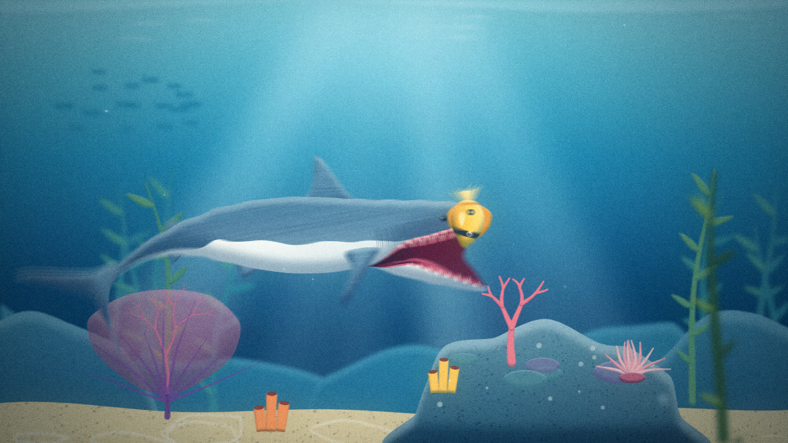
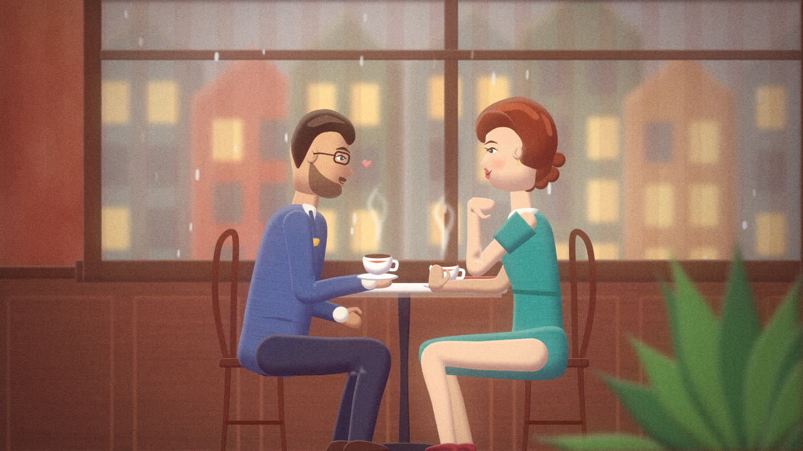
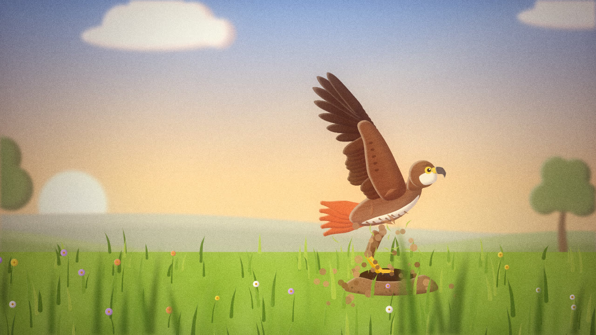
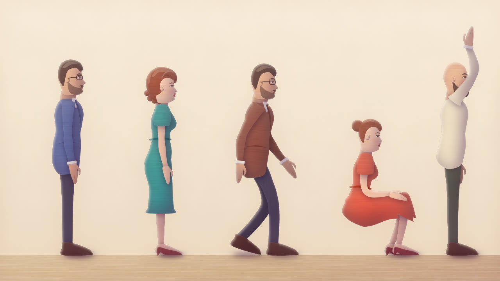
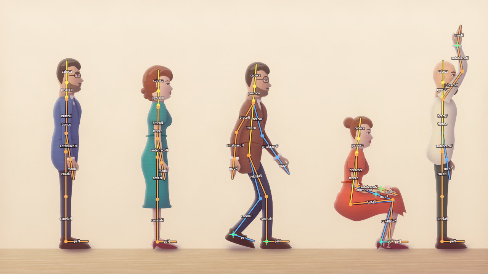
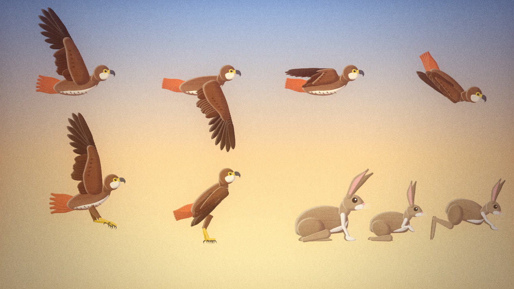
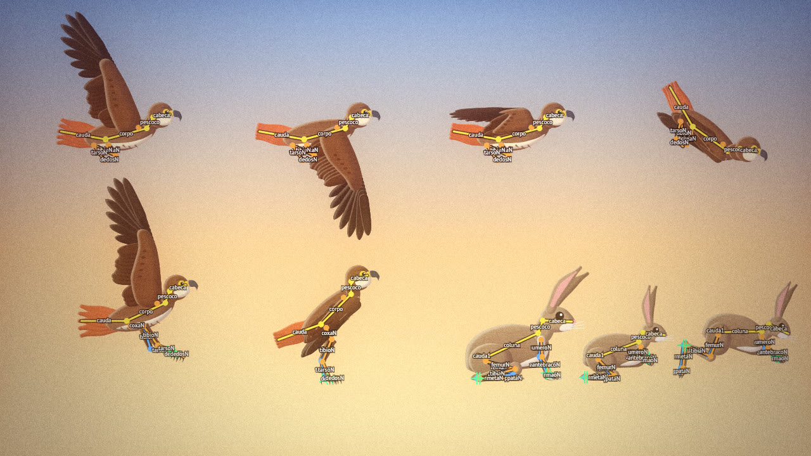
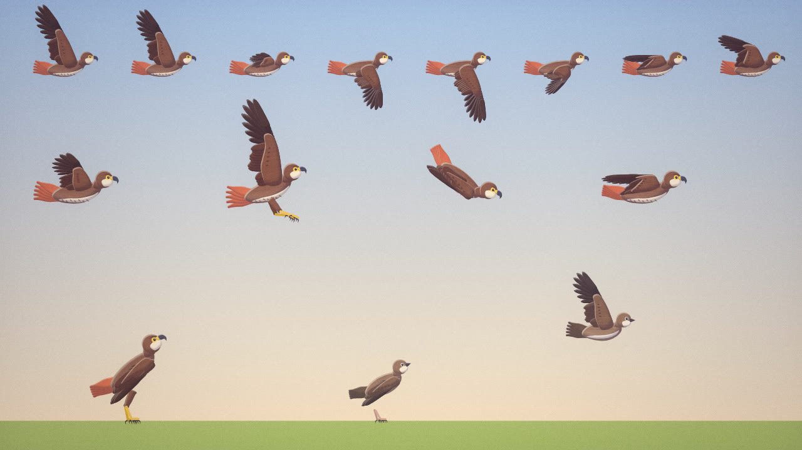

# bamoonimation 🎬

**Motor de animação 2D ilustrada, feito para agentes de IA escreverem cenas em código e renderizarem vídeo em qualquer FPS.**

O visual-alvo é o de explainers ilustrados no estilo *mid-century / editorial*: formas chapadas com sombra
própria em "meia-lua", luz quente e sombras frias, textura de grão e pincel, profundidade de campo
(fundo enevoado e primeiro plano desfocado) e câmera com parallax. A história é contada com imagem e
movimento — **sem texto na tela** por padrão.

O motor oferece **primitivas e técnicas de desenho** (formas suaves, pinceladas afinadas, corpos ao redor
de uma espinha, partículas, raios de luz, camadas de profundidade, sombreamento automático) para que um
agente desenhe *qualquer coisa* com poucas linhas — e renderize rápido, em paralelo. Para personagens há
**anatomia embutida**: esqueletos de referência (humano, quadrúpede, ave, peixe) com proporções reais e
limites articulares, uma **figura humana base pronta** (homem e mulher, `pessoa()`), caminhada anatômica
(`caminhada()`) e um **verificador** (`bamoo check`) que acusa poses impossíveis, pés deslizando,
camadas fora de ordem e texto na tela.

| Tubarão caçando | Casal na cafeteria |
|---|---|
|  |  |
| **Foguete decolando** | **Gavião atacando um coelho** |
|  |  |

Vídeos completos (prévias em 720p — rode `render` para 1080p/4K em qualquer FPS): [`media/shark.mp4`](media/shark.mp4) · [`media/cafe.mp4`](media/cafe.mp4) ·
[`media/rocket.mp4`](media/rocket.mp4) · [`media/hawk.mp4`](media/hawk.mp4) — código em [`scenes/`](scenes/).

---

## Sumário

1. [Instalação](#instalação)
2. [Início rápido](#início-rápido)
3. [Fluxo de trabalho para agentes](#fluxo-de-trabalho-para-agentes)
4. [Conceitos](#conceitos)
5. [Referência da API](#referência-da-api)
6. [Como chegar no estilo (boas práticas)](#como-chegar-no-estilo-boas-práticas)
7. [Personagens e anatomia](#personagens-e-anatomia)
8. [Técnicas de animação](#técnicas-de-animação)
9. [Desempenho e tamanho de arquivo](#desempenho-e-tamanho-de-arquivo)
10. [Os benchmarks](#os-benchmarks)
11. [Estrutura do repositório](#estrutura-do-repositório)

---

## Instalação

Requisitos: **Node.js 18+** e **ffmpeg** no `PATH` (só para gerar vídeo; PNGs não precisam).

```bash
git clone https://github.com/MusicMaster4/bamoonimation.git
cd bamoonimation
npm install
node bin/bamoo.js help
```

O desenho usa [Skia](https://skia.org) via `@napi-rs/canvas` (binários pré-compilados para Windows, macOS e
Linux — sem compilar nada). Opcional: `npm link` para ter o comando `bamoo` global.

> **Onde salvar as cenas:** dentro da pasta do projeto (ex.: `cenas/`, `scenes/`). Assim o
> `import ... from 'bamoonimation'` funciona sozinho (auto-referência do pacote). Fora dela, rode
> `npm link` aqui e `npm link bamoonimation` no outro projeto, ou importe por caminho relativo (`../src/index.js`).

## Início rápido

```bash
node bin/bamoo.js new cenas/teste.js                 # cria uma cena a partir do modelo
node bin/bamoo.js still cenas/teste.js -t 2 --grid   # out/teste_t2.00.png (com grade de coordenadas)
node bin/bamoo.js sheet cenas/teste.js               # out/teste_sheet.jpg (12 momentos numa imagem)
node bin/bamoo.js render cenas/teste.js --fps 60     # out/teste.mp4
```

Comandos:

| comando | o que faz |
|---|---|
| `new <cena.js>` | cria um arquivo de cena a partir do modelo |
| `still <cena.js> -t 1.5[,3,4.2] [--scale 0.5] [--grid]` | renderiza quadros PNG (padrão: escala 0.5) |
| `sheet <cena.js> [-n 12] [--cols 4] [--scale 0.25] [--from s] [--to s] [--grid]` | folha de contato JPG — a forma mais barata de "ver" a animação |
| `render <cena.js> [--fps 30] [--scale 1] [--from s] [--to s] [--workers N] [--crf 18] [--format mp4\|webm\|mov\|gif\|png] [--audio arq]` | vídeo final, renderizado em paralelo |
| `check <cena.js> [--fps 12] [--allow-text]` | **verificador**: ordem das camadas, texto na tela, articulações fora do limite, membros além do alcance, proporções, simetria, pés afundando/deslizando, teletransportes. Sai com código 1 se houver erro |
| `still/sheet ... --rig` / `--layers` | sobreposições de depuração: esqueletos (vermelho = problema, cruz verde = alvo IK) / cada camada tingida com legenda de z |
| `info <cena.js>` | duração, planos, camadas, nº de quadros por FPS |
| `bench <cena.js>` | mede ms/quadro |

Qualquer FPS funciona (24, 30, 60, 120…): a cena é uma **função contínua do tempo**, nada é simulado
quadro a quadro. Partículas são analíticas — por isso cada worker renderiza seu trecho de forma independente.

## Fluxo de trabalho para agentes

O objetivo é **gastar poucos tokens** e **convergir rápido**:

1. **Composição primeiro** — escreva cenário + personagens parados e rode `still --grid`. A grade mostra as
   coordenadas de design (1920×1080) para posicionar tudo sem adivinhar.
2. **Personagem isolado** — desenhe criaturas/pessoas numa cena de teste (`export const poseTest = scene(...)`)
   com várias poses lado a lado, como em `scenes/hawk.js`. Ajuste até ficar bom, depois anime.
3. **Tempo e movimento** — `sheet` mostra 12 instantes numa única imagem. Use `--from/--to` para olhar um
   trecho (ex.: um impacto). Isso substitui assistir ao vídeo.
4. **Verificação** — `check` até zerar os erros; `sheet --rig` nos trechos de ação dos personagens.
5. **Vídeo** — `render --scale 0.5` para prévia, depois `render` final (1080p) ou `--scale 2` (4K).
6. Escreva cada plano como uma `scene` e junte com `film([...])` com transições.

Regras padrão para agentes: **sem texto na tela** (a menos que o pedido peça), **personagens sempre com
esqueleto** (`pessoa()` / `rig()`), e **`check` sem erros** antes do render. Veja [`docs/ANATOMIA.md`](docs/ANATOMIA.md).

Arquivo [`AGENTS.md`](AGENTS.md) é a referência compacta pensada para caber no contexto de um agente.

## Conceitos

### Cena, filme e planos

```js
import { scene, film, layer, G, blob, circle, kf, lin } from 'bamoonimation';

const plano1 = scene({
  dur: 6,                                   // segundos
  size: [1920, 1080],                       // espaço de design (padrão)
  bg: lin(90, '#8fb8de', '#f3d3b0'),        // fundo (cor ou gradiente; pode ser animado)
  look: { sun: [-0.6, -0.8] },              // luz, névoa, grão, grade de cor... (ver abaixo)
  camera: { x: kf([0, 900], [6, 1020]), dof: 6 },
  layers: [ layer({ z: 4 }, [...]), layer({ z: 1 }, [...]), layer({ z: 0.5 }, [...]) ],
  fadeIn: 0.6, fadeOut: 0.8,
});
export default film([plano1, plano2], { trans: 'cross', d: 0.6 }); // cross | black | white | wipe | cut
```

### Camadas e profundidade (`layer`)

Cada camada tem uma profundidade `z` (1 = plano focal). É o que dá o aspecto de "câmera multiplano":

- **parallax**: ao mover a câmera, camadas com `z` maior se movem menos (`deslocamento ÷ z`);
- **névoa atmosférica**: camadas com `z > 1` se misturam com `look.haze.c` (`a × (1 − 1/z)`);
- **profundidade de campo**: com `camera.dof`, o desfoque cresce com `|focus/z − 1|` — o fundo fica suave e o
  primeiro plano (`z < 1`) bem desfocado. Camadas desfocadas são desenhadas em meia/quarta resolução (rápido);
- `camera.dolly` aproxima a câmera fisicamente (parallax de escala); `zoom` é zoom de lente;
- `layer({ fixed: true })` ignora a câmera (títulos, HUD). Props: `z, blur, haze, alpha, blend, glow, show`.

### Nós e props

Todo nó aceita transformação `x y rot s sx sy px py skx flip alpha show:[t0,t1]`
(`px/py` = pivô de rotação/escala). Estilos: `fill stroke lw shade hl tex glow blur blend drop`.
`fill, shade, hl, tex, sun, light, shadow, stroke, lw` são **herdados** — defina uma vez no grupo/camada.

### Valores animados

Qualquer prop (inclusive pontos de formas) pode ser:

```js
x: 300                                         // fixo
x: kf([0, 100], [1.5, 600, 'out'], [2, 560, 'back'])   // keyframes (easing do trecho que chega)
x: t => 960 + 200 * Math.sin(t)                // função do tempo (segundos da cena)
pts: kf([0, bocaFechada], [0.3, bocaAberta])   // morphing de formas (mesmo nº de pontos)
fill: kf([0, '#203060'], [3, '#f0a070'])       // cores interpolam em OKLab
```

## Referência da API

### Formas

| fábrica | descrição |
|---|---|
| `blob(pts, p)` | forma fechada **suave** passando pelos pontos. Ponto `[x, y, r]`: `r=0` quina viva, `r>1` mais bojudo. É a ferramenta nº 1 |
| `poly(pts, {r})` | polígono (r arredonda os cantos) |
| `rect(x, y, w, h, {r})`, `circle(cx, cy, r)`, `ellipse(cx, cy, rx, ry)` | primitivas |
| `path('M0 0 C ...')` | path SVG (use `rule: 'evenodd'` para furos, ex.: parede com janela) |
| `taper(pts, w, p)` | pincelada afinada ao longo da curva. `w`: número, `[w0, w1, ...]` (perfil suave) ou `u => w`. `grow: 0..1` "desenha" o traço. `caps: 'round'\|'flat'` |
| `line(pts, {stroke, lw, dash, closed, grow})` | traço de largura constante |
| `limb(a, b, [l1, l2], [w0, wJunta, w1], p)` | membro com IK de 2 ossos do ponto `a` ao alvo `b`. `bend: ±1`, `end: nó` (mão/pé) com `endRot` ou `endAbs` |
| `text(str, {font, size, fill, align, lh, ls, reveal, stroke, drop})` | fontes embutidas: `hand` (Patrick Hand), `serif` (DM Serif Display), `mono` (Special Elite), `sans` (PT Sans), `script` (Caveat). `registerFont(arquivo)` para outras |
| `img(arquivo, {w, h})` | imagem PNG/JPG |

### Estrutura

| fábrica | descrição |
|---|---|
| `G(props, filhos)` / `G(filhos)` | grupo. `clip: forma` recorta; `merge: true` une todos os filhos numa silhueta única sombreada (nuvens, fumaça, copas); `iso` isola a opacidade |
| `layer(props, filhos)` | camada de profundidade (só em `scene.layers`) |
| `dyn((t, env) => nós)` | nós gerados por quadro (criaturas com espinha, IK manual, listas variáveis) |
| `custom((ctx, t, env) => {...})` | desenho livre com a API Canvas 2D |
| `scatter(n, seed, (r, i) => nó)` | n variações determinísticas (`r` = RNG com `r()`, `r.range(a,b)`, `r.pick(arr)`, `r.int`) |
| `rep(n, i => x)` | repetição simples (nós ou pontos) |

### Efeitos

| fábrica | descrição |
|---|---|
| `particles({...})` | `rate` (por s) e/ou `burst` (n de uma vez em `t0`), `t0, t1, life:[a,b], at:[x,y] \| t=>[x,y], area: r \| [w,h], dir, spread, speed:[a,b], grav:[gx,gy], drag, size:[a,b], grow, color \| [cores], colorEnd, alphaVar, fadeIn, fadeOut, turb, spin, stretch, inherit, blur, glow, blend, merge, shape: p => nó` |
| `rays({at, ang, spread, n, len, w:[a,b], w0, c, a, sway, speed, fade, blur})` | feixes de luz (sol pela janela, luz subaquática, holofote) |
| props `glow`, `blur`, `drop`, `blend` | brilho, desfoque, sombra projetada, modos de mesclagem (`multiply screen overlay add soft ...`) |
| `tex` | textura dentro da forma: `grain`, `speckle` (respingos), `brush` (pincel seco), `paper`, `hatch`, `blot` (manchas) — ou `{k, a, s, rot, mode}` |

### Pinturas

`'#rrggbb'`, `'#rrggbbaa'`, `rgba()`; `lin(ângulo, ...cores)` (relativo à caixa da forma, 90° = de cima para
baixo) ou `lin([x0,y0,x1,y1], ...)`; `rad(null, ...cores)` (centro, termina na borda) ou
`rad({x, y, r}, ...)`; atalho `['#topo', '#base']`. Paradas com posição: `[0.3, '#fff']`.
Utilitários de cor: `mix(a, b, t)` (OKLab), `lighten`, `darken`, `alpha`, `adj(c, {l, c, h})`.

### Animação

| helper | descrição |
|---|---|
| `kf([t, v, ease], ...)` | keyframes; `.loop(p)`, `.delay(s)`, `.at(t)` |
| `ease.*` | `linear in out inOut in2 out2 inOut2 sine expoIn expoOut expo back backIn backInOut elastic bounce step` |
| `tw(t, t0, t1, a, b, e)`, `prog(t, t0, t1, e)` | tween / progresso 0..1 |
| `osc(freq, amp, fase, base)`, `wig(freq, amp, seed, base)` | oscilação senoidal / tremor orgânico (como props) |
| `noise(x, seed)`, `fbm`, `rng(seed)`, `hash` | aleatoriedade determinística |
| `spline([t, [x,y]], ...)` + `move(pos, {orient})` + `heading(pos, t)` | trajetórias suaves e orientação pelo movimento |
| `blink(t, seed)`, `talk(t, t0, t1, seed)`, `breathe` | vida de personagem (piscar, falar, respirar) |
| `gait(dist, {stride, lift, duty, phase})`, `gaitPhase` | passadas com pé plantado, dirigidas pela distância percorrida |
| `cycle`, `pulse`, `decay`, `spring`, `between`, `smooth`, `clamp`, `lerp`, `remap` | utilidades |

### Geometria

| helper | descrição |
|---|---|
| `body(espinha, topo, baixo, {n})` | contorno de criatura ao redor de uma espinha (cauda→cabeça, voltada para +x). Perfis: arrays ou funções `u => meia-altura` |
| `wave(pts, t, {amp, freq, len, dir})` | onda viajante perpendicular (nadar, cauda, alga, bandeira) |
| `along(pts, u)` | `{x, y, ang, nx, ny}` na fração `u` da curva — para prender nadadeiras, folhas, olhos |
| `ik2(a, b, l1, l2, bend)` | articulação de 2 ossos |
| `profile([...])` | função de perfil suave `u => valor` |
| `sampleCurve`, `xf`, `mirror`, `ellipsePts`, `polar`, `bboxPts` | utilidades de pontos |

### Câmera e `look`

```js
camera: { x, y, zoom, rot, dolly, focus, dof, shake, shakeF }
look: {
  sun: [-0.55, -0.85],      // direção PARA a luz (y para baixo) — define todas as sombras próprias
  light: '#fff2d8',         // cor do realce (lado iluminado)
  shadow: '#3e3470',        // cor da sombra própria (multiply) — use roxos/azuis
  shade: 0.42, hl: 0.22,    // força padrão da sombra / realce (0 desliga)
  shadeD: 0.22, hlD: 0.07, soft: 0.3,   // tamanho e suavidade da "meia-lua"
  tex: null,                // textura padrão de todas as formas
  haze: { c: '#c9d6e3', a: 0.5 },       // névoa para z > 1
  grain: 0.08, grainFps: 12,            // grão de filme (0 = desliga; grainFps 0 = estático)
  vignette: 0.32, vignetteC: '#1a0f2e',
  bloom: 0.15,                          // brilho das luzes
  grade: { sat, con, bri, tint, tintA, lift },  // grade de cor ("lift" ergue os pretos: aspecto de filme)
  paper: 0, bars: 0,                    // papel global / tarjas de cinema
  steps: 0,                             // 12 => anima "em dois" (12 poses/s), câmera continua suave
  mblur: 0, shutter: 0.5,               // motion blur (nº de subquadros) — pode ser função de t
  caption: { font: 'hand', size: 46, c: '#fff', y: 0.885 },
}
```

Todo item do `look` pode ser animado (ex.: `mblur: t => t > 2 && t < 3 ? 4 : 0`).

## Como chegar no estilo (boas práticas)

O que faz o visual "parecer desenho de verdade" — aprendido construindo os benchmarks:

**Composição**
- Pense em **3 planos**: fundo (`z` 4–30, enevoado), ação (`z = 1`), primeiro plano (`z ≈ 0.5`, escuro, grande,
  cortado pela borda e desfocado). O primeiro plano é o que mais "vende" a profundidade.
- Desenhe fundos e chão com **sobra de ~400 px** além da tela: câmera, zoom e desfoque revelam as bordas.
- Emoldure a ação com elementos nas laterais (plantas, rochas, capim) e deixe respiro onde o olho deve ir.

**Luz e cor**
- Uma luz principal coerente (`look.sun`). Sombras frias e saturadas (roxo/azul) e realces quentes —
  nunca preto puro. `shade`/`hl` automáticos já criam o volume em "meia-lua" típico da ilustração.
- Contraste **quente × frio** entre ambiente e personagem (parede terracota × roupas azul/verde; chuva azul lá fora).
- Para luz vinda de baixo (fogo, lava), troque `sun`/`light` só no grupo: `{ sun: [0.3, 1], light: '#ffb35c' }`.
- `glow` em fontes de luz (lâmpadas, sol, chamas, janelas acesas), `rays` para feixes, `lightPool` (círculo com
  gradiente radial em `blend: 'screen'`) para manchas de luz na parede.
- Ajuste final com `look.grade` (saturação/contraste/tinta) e `vignette`.

**Forma e textura**
- Silhuetas grandes e legíveis com `blob`; detalhes com `taper` (cabelo, sobrancelha, dobras, nervuras, capim).
- Evite contorno preto em tudo: o estilo usa **separação por valor e sombra própria**. Linhas só em detalhes.
- Textura sutil nas superfícies grandes (`brush` em roupas/pelos, `speckle` em pedra/terra, `blot` em paredes).
- Nuvens, fumaça, copas de árvore: `G({ merge: true })` ou partículas com `merge: true` + `shade: { dp }`
  (distância absoluta da meia-lua ≈ raio médio dos "gomos").

**Personagens**
- Perfil é mais fácil e elegante (como na referência). Proporção de ~6 cabeças de altura.
- Construa o rosto com 1 `blob` de perfil (testa, nariz, lábios, queixo), olho amendoado com pálpebra animada por
  `blink`, boca com `talk`, sobrancelha com `taper` que sobe para expressões. Cabelo em 2 camadas (volume atrás e
  mecha na frente) + forma de brilho mais clara.
- Corpo: tronco `blob`, braços e pernas com `limb` (IK). Defina alvos das mãos/pés como funções de `t`.
- Membros do lado de lá: mesma forma, cor `darken(cor, 0.08)`, desenhados antes do tronco.
- Veja `person()` em `scenes/cafe.js`, `shark()` em `scenes/shark.js`, `hawk()`/`rabbit()` em `scenes/hawk.js`.

**Movimento**
- Nada parado: plantas com `osc`, água com `wave`, respiração, piscadas, partículas no ar.
- Antecipação e assentamento: easings `back`, `out`, `spring`; impactos com `shake: t => k * decay(t, t0)` e um
  pequeno "soco" de zoom.
- Ação rápida: `mblur` só no trecho rápido (custa ×N), partículas `stretch`, rastros.
- Câmera sempre com movimento lento (pan/zoom/dolly) — dá vida mesmo a planos parados.
- Sem texto: conte com enquadramento, expressão e ação (ex.: a contagem do foguete é feita com luzes que
  acendem). Se o pedido exigir texto, `captions: [[t0, t1, 'texto']]` e `text()` existem (fonte manuscrita) —
  rode o `check` com `--allow-text`.

## Personagens e anatomia

Guia completo: [`docs/ANATOMIA.md`](docs/ANATOMIA.md). Em resumo:

```js
import { pessoa, caminhada, rig, skeleton, kf, talk } from 'bamoonimation';

const CHAO = 980;
const ELA = { sexo: 'f', altura: 700, cabelo: 'ondulado', roupa: 'vestido', cores: { cima: '#2e8a83', baixo: '#2e8a83' } };
// em pé, falando e sorrindo, segurando uma xícara
pessoa({ ...ELA, x: 500, y: CHAO - pessoa.quadril(ELA), ground: CHAO,
  ik: { maoN: [70, -110], angMaoN: -6 }, segura: { N: xicara }, rosto: { fala: t => talk(t, 1, 3), sorriso: 0.6 } });
// andando: pé plantado, rolamento do pé, quadril em arco, braços em oposição
const x = kf([0, 0], [4, 1550, 'sine']);
pessoa({ ...ELA, x: t => x.at(t), ground: CHAO, ...caminhada(ELA, { x, chao: CHAO }) });
// animal: esqueleto de referência + peles presas aos ossos
rig({ name: 'cão', plan: 'quadrupede', bones: skeleton('quadrupede', { altura: 300, variante: 'cao' }), pose: {...}, ik: [...], skin: [...] });
```

| peça | o que faz |
|---|---|
| `skeleton(plano, opts)` | ossos com proporções reais e limites articulares: `humano` (`altura, cabecas, sexo`), `quadrupede` (`altura, variante: cao/gato/cavalo/coelho`), `ave` (`tamanho`), `peixe` (`comprimento, segmentos`) |
| `rig({ bones, pose, ik, skin, ground, plan, name })` | esqueleto animado: `pose` (ângulos por osso), `ik` (cadeias de 2–3 ossos; escolhe a dobra válida), `skin` (desenhos presos aos ossos, ordem automática lado de lá → lado de cá) |
| `pessoa({...})` | **figura humana base** pronta (homem/mulher): corpo de perfil anatômico, mãos, pés, rosto com piscar/fala/sorriso, cabelos, barba, óculos, roupas, objetos nas mãos |
| `caminhada(pessoaOpts, { x, chao })` | andar realista sem patinar (devolve `y`, `pose`, `ik` prontos) |
| `ave({...})`, `ASA`, `bater(t, freq)` | **ave base** (rapina ou pássaro): asa com dobra em Z modelada na própria planta e projetada pela elevação (a borda de fuga fica sempre para trás), poses prontas (planando, freio, dobrada...) e batida realista |
| `bamoo check` | verificador de anatomia, chão, camadas e texto |

| figura base (`pessoa()`) | com `--rig` (ossos; vermelho = problema) |
|---|---|
|  |  |
|  |  |

Pranchas de referência para inspecionar: [`scenes/testes/pessoas.js`](scenes/testes/pessoas.js) (poses),
[`scenes/testes/andar.js`](scenes/testes/andar.js) (caminhada), [`scenes/testes/aves.js`](scenes/testes/aves.js) (ciclo de batida e poses de aves), `poseTest` em [`scenes/hawk.js`](scenes/hawk.js) (gavião e coelho).



## Técnicas de animação

**Criatura nadando** (espinha + onda + corpo):

```js
dyn(t => {
  const base = rep(12, i => [-500 + (i / 11) * 1000, 0]);                        // cauda -> cabeça
  const sp = wave(base, t * 0.75, { amp: u => 3 + 70 * (1 - u) ** 2, len: 1.25, dir: -1 });
  const nadadeira = along(sampleCurve(sp), 0.6);                                   // prende detalhes na curva
  return G([
    blob(body(sp, [6, 30, 90, 116, 60, 15], [6, 26, 70, 84, 40, 10]), { fill: '#5d7c92' }),
    blob(FIN, { x: nadadeira.x, y: nadadeira.y, rot: nadadeira.ang }),
  ]);
});
```

**Andar com pés plantados** (o pé de apoio não escorrega mesmo freando):

```js
const x = kf([0, -500], [5, 740, 'out']);                    // quadril
footN: t => { const [dx, dy] = gait(x.at(t) + 500, { stride: 150, lift: 34 }); return [dx, 336 + dy]; },
footF: t => { const [dx, dy] = gait(x.at(t) + 500, { stride: 150, lift: 34, phase: 0.5 }); return [dx, 336 + dy]; },
```

Para parar com os dois pés no chão: distância total = `(n + 0.525) × stride / duty`.

**Fumaça volumosa iluminada pelo fogo**:

```js
particles({ rate: 30, at: [960, 900], dir: 180, spread: 26, speed: [380, 620], drag: 1.3, grav: [0, -30],
  size: [24, 46], grow: 3.4, merge: true, fill: '#efe6da',
  sun: [0.3, 1], light: '#ffb35c', shadow: '#5e4b74', shade: { a: 0.55, dp: 30 }, hl: { a: 0.85, dp: 16 } })
```

**Boca abrindo** (morphing por pontos ou rotação de mandíbula), **piscar** (retângulo da cor da pele recortado
pelo olho com `sy: t => blink(t, seed)`), **orelhas/caudas** (`taper` + `rot` com `osc`), **chuva**
(`particles` com `stretch`), **vapor** (`taper` + `wave` + `blur` em `screen`) — todos nos benchmarks.

## Desempenho e tamanho de arquivo

- O render divide os quadros entre **processos** (padrão `núcleos − 2`, máx. 20; ajuste com `--workers`), cada um com
  seu próprio ffmpeg; os segmentos são concatenados sem recodificar. (Processos escalam ~2× melhor que worker threads
  com o Skia; `--threads` força threads.)
- Desfoque é o que mais custa no Skia; o motor limita cada blur à área da forma e desenha camadas desfocadas em
  resolução reduzida. Ainda assim: prefira `dof` moderado e `blur` em poucos elementos.
- `mblur` multiplica o custo pelos subquadros — use só nos trechos rápidos (é animável).
- Partículas com `merge` usam operações de path; centenas de partículas por emissor são ok.
- **Tamanho do vídeo**: o grão animado é ruído e encarece a compressão (padrão: muda 8×/s, `--crf 20`). Para
  arquivos menores use `grainFps: 0` (grão fixo, como textura de papel — ~metade do tamanho), `grain` menor ou `--crf 23`.
- Cada `glow`/`blur` é um desfoque: evite dezenas deles (ex.: janelas acesas numa camada que já está desfocada).
- Prévias: `--scale 0.5` (4× menos pixels). 4K: `--scale 2`.

## Os benchmarks

Quatro cenas completamente diferentes, construídas só com as primitivas do motor:

| cena | o que exercita |
|---|---|
| [`scenes/shark.js`](scenes/shark.js) — tubarão caçando um peixe (3 planos) | criatura por espinha + onda, mandíbula articulada, cáusticas, raios subaquáticos, névoa azul, bolhas, motion blur, tremor de câmera |
| [`scenes/cafe.js`](scenes/cafe.js) — casal se conhecendo numa cafeteria (3 planos) | figuras base `pessoa()` (homem e mulher), `caminhada()` com pés plantados, gestos por IK dentro dos limites (oferecer a cadeira, beber, rir com a mão no peito), piscar/falar/sorrir, interior com janela, chuva, vapor, luzes |
| [`scenes/rocket.js`](scenes/rocket.js) — foguete decolando (3 planos) | fumaça volumosa iluminada por baixo, chama tremulando, contagem regressiva com luzes (sem texto), câmera acompanhando, transição dia → espaço com estrelas |
| [`scenes/hawk.js`](scenes/hawk.js) — gavião atacando um coelho (3 planos) | base `ave()` (asa anatômica projetada: batida, mergulho com asas fechadas, freio com garras à frente, pouso e decolagem) e rig `quadrupede/coelho` (salto dirigido pela distância com patas plantadas), capim ao vento, sombra passando, impacto, fuga e espiada da toca (recortada na linha do chão) |

Tempos de render (1080p, 30 fps, Ryzen 9 5900X, 20 processos): ~11–12 quadros/s — cada filme de ~17 s (≈520 quadros)
leva ~50 s. Prévias com `--scale 0.5` são ~3–4× mais rápidas; `still`/`sheet` saem em 1–3 s.

## Estrutura do repositório

```
bin/bamoo.js          CLI
src/
  index.js            API pública (importe de 'bamoonimation')
  nodes.js            fábricas de nós (blob, taper, limb, particles, scene, film...)
  anim.js             keyframes, easings, osciladores, ruído, gait, spline...
  geom.js             splines, taper, body, wave, along, ik2
  color.js            cores e misturas em OKLab
  render.js           renderer Skia (camadas, sombreamento, texturas, partículas, raios, pós)
  rig.js              esqueletos: FK, IK com limites, peles presas aos ossos
  anatomy.js          esqueletos de referência (humano, quadrúpede, ave, peixe) e regras de proporção
  pessoa.js           figura humana base (homem/mulher) + caminhada anatômica
  ave.js              ave base (rapina/pássaro) com asa anatômica projetada + poses de voo
  check.js            verificador (bamoo check)
  textures.js         texturas procedurais
  fonts.js            fontes embutidas
  cli.js, worker.js   linha de comando e render paralelo
scenes/               os 4 benchmarks + hello.js (exemplo mínimo)
scenes/testes/        pranchas de referência (pessoas, caminhada, poses de animais)
docs/ANATOMIA.md      guia de anatomia para personagens
assets/fonts/         fontes livres (OFL/Apache) com licenças
media/                prévias dos benchmarks
AGENTS.md             referência compacta para agentes
```

## Licença

Código sob licença MIT. Fontes em `assets/fonts/` sob suas próprias licenças livres (OFL / Apache 2.0, arquivos incluídos).
